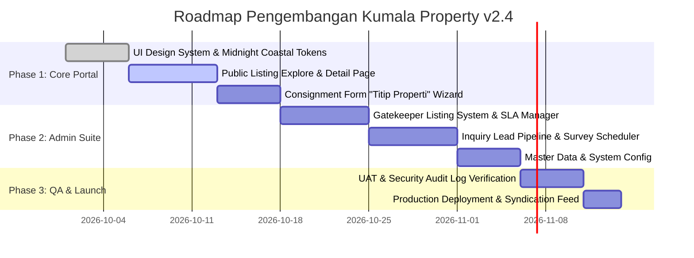

# Product Requirement Document (PRD)
## System Platform: Kumala Property (Midnight Coastal Edition)

---

## 1. Document Overview & Executive Summary

### 1.1 Executive Summary
**Kumala Property Management System & Public Portal v2.4** (dengan tema desain *Midnight Coastal*) adalah platform real estate mewah (*luxury real estate atelier*) terpadu yang dirancang untuk menghubungkan pemilik properti bernilai tinggi, calon pembeli/penyewa eksklusif, serta tim manajemen & kurator internal Kumala Property.

Platform ini menyediakan pengalaman pencarian hunian dan aset investasi mewah yang intuitif di sisi publik, serta sistem administrasi end-to-end (Gatekeeper Listing, CRM Pipeline Inquiry, Audit Closing, dan Manajemen Master Data) yang presisi di sisi manajemen.

### 1.2 Product Vision & Objectives
* **Visi**: Menjadi benchmark platform transaksi real estate mewah terdepan di Indonesia dengan mengombinasikan kurasi arsitektural ketat, transparansi legalitas 100%, serta proteksi kerahasiaan klien kelas atas.
* **Tujuan Utama**:
  1. **Digitalisasi Konsinyasi ("Titip Properti")**: Menyediakan formulir pengajuan konsinyasi multi-tahap dengan validasi legalitas BPN otomatis dan SLA verifikasi < 4 jam.
  2. **Eksplorasi Properti Presisi**: Memberikan fitur pencarian multi-parameter (wilayah strategis, tipe properti, skema jual/sewa, dan rentang harga) dengan UI/UX premium.
  3. **Manajemen Operational & Lead Pipeline**: Mempercepat *response time* inquiry ke calon pembeli dengan SLA < 15 menit dan melacak konversi survei lokasi hingga closing transaksi.
  4. **Keamanan & Kepatuhan Legal**: Memastikan setiap aset terverifikasi dokumen SHM/HGB, PBG/IMB, PBB, serta diaudit oleh notaris/PPAT rekanan.

---

## 2. Stakeholders & User Personas

| Role | Deskripsi User | Key Needs & Pain Points |
| :--- | :--- | :--- |
| **Calon Pembeli / Penyewa (High-Net-Worth Individual - HNWIs)** | Investor, ekspatriat, atau pembeli hunian mewah yang mencari properti terkurasi. | Menginginkan foto HD, detail arsitektur presisi, kepastian legalitas, simulasi jadwal survei, dan privasi penuh saat menghubungi agen. |
| **Pemilik Properti (Vendor / Seller)** | Pemilik unit villa, rumah komersial, penthouse, atau tanah yang ingin menjual/menyewakan unitnya. | Membutuhkan proses konsinyasi yang jelas, penaksiran valuasi objektif (CMA), pendampingan hukum, dan transparansi promosi. |
| **Admin & Kurator Properti (Internal Team)** | Tim admin operasional yang memverifikasi kelengkapan berkas, foto fasad/interior, serta legalitas sertifikat. | Membutuhkan Gatekeeper Listing system, checklist kurasi standar, manajemen status dokumen, dan pembuatan catatan privat. |
| **Sales Advisor / Private Client Concierge** | Agen penanggung jawab follow-up lead dan pendamping survei lokasi. | Membutuhkan notifikasi real-time via WhatsApp, alokasi jadwal survei harian, dan metrik konversi transaksi. |
| **Super Admin / Management** | Direksi dan manajer cabang yang memantau performa bisnis dan portofolio. | Membutuhkan analytics dashboard harian, laporan closing harian, audit log sistem, serta kendali master data regional. |

---

## 3. Brand Identity & Design System Specs

* **Theme Name**: *Midnight Coastal*
* **Color Palette**:
  * **Primary Navy**: `#0E2238` / `#162E4A` (Mencerminkan ketenangan, kemewahan, dan profesionalisme)
  * **Accent Teal / Emerald**: `#00B488` / `#0D9488` (CTA utama, status aktif, WhatsApp connect)
  * **Background Light Coastal**: `#F4F6F9` / `#EBF1F5` (Kanvas bersih modern)
  * **Text Dark Primary**: `#1E293B`
  * **Status Badges**:
    * *Review / Pending*: Soft Amber (`#FEF3C7` / `#D97706`)
    * *Approved / Valid*: Emerald Green (`#D1FAE5` / `#059669`)
    * *Revision Required*: Soft Rose (`#FFE4E6` / `#E11D48`)
* **Typography**:
  * **Headings**: Modern Geometric Sans (Outfit / Plus Jakarta Sans)
  * **Body & UI Controls**: Inter / Roboto
* **Visual Components**: Soft glassmorphism cards, rounded borders (8px - 16px), subtle inner drop-shadows, responsive badges, and clean metric widgets.

---

## 4. System Architecture & Module Structure

Kumala Property dibagi menjadi 2 ekosistem utama:

```mermaid
graph TD
    SubApp1[Public Portal - Website Utama] --> Page1[Landing Page]
    SubApp1 --> Page2[Explore Properti]
    SubApp1 --> Page3[Detail Properti & Concierge Form]
    SubApp1 --> Page4[Titip Properti / Consignment Form]
    SubApp1 --> Page5[Properti Favorit Saya]
    SubApp1 --> Page6[Tentang Kami & Kontak]

    SubApp2[Admin Suite - Portal Kontrol Internal] --> Admin1[Login Admin & Security Protocol]
    SubApp2 --> Admin2[Admin Dashboard & Operational Metrics]
    SubApp2 --> Admin3[Manajemen Properti / Inventory Hub]
    SubApp2 --> Admin4[Manajemen Listing Masuk / Gatekeeper Verification]
    SubApp2 --> Admin5[Riwayat Terjual & Tersewa / Closing Archive]
    SubApp2 --> Admin6[Manajemen Data Inquiry & Lead Pipeline]
    SubApp2 --> Admin7[Pengaturan Sistem & Master Data]
```



---

## 5. Functional Requirements - Public Web Portal

### 5.1 Landing Page & Navigation Header/Footer
* **Header Bar**:
  * Logo resmi Kumala Property dengan tagline "Jual & Sewa Properti Eksklusif".
  * Navigasi utama: `Beranda`, `Explore Property`, `Titip Property`, `Tentang Kami & Kontak`.
  * Badge Counter Properti Favorit (menampilkan jumlah unit tersimpan lokal).
  * Tombol CTA Cepat: `Hubungi Kami` (direct link ke WhatsApp Concierge).
* **Hero Banner**: Highlight penawaran konsinyasi & eksplorasi listing kurasi pilihan.
* **Footer System**:
  * Ringkasan Profil Perusahaan & Layanan (Jual, Sewa, Konsultasi).
  * Navigasi Cepat & Kebijakan Privasi / Syarat Ketentuan.
  * Alamat Kontak & Kantor Operasional (Kantor Pusat Jakarta & Kantor Perwakilan Bali).
  * Jam Operasional Kantor & Tombol "Jadwalkan Private Tour".
  * Link Terbatas ke `Portal Admin` di sudut kanan bawah footer.

### 5.2 Explore Properti Page (`Explore Properti`)
* **Multi-Parameter Search Bar**:
  1. *Jenis Transaksi*: Toggle `Semua`, `Jual`, `Sewa`.
  2. *Kategori Properti*: Dropdown (`Rumah Mewah`, `Apartemen / Penthouse`, `Tanpa Komersial`, `Ruko / Shophouse`, `Villa`).
  3. *Lokasi Properti*: Dropdown Wilayah Strategis (`Jakarta Selatan`, `Bali - Badung/Canggu/Uluwatu`, `Surabaya`, `BSD City`, `Bandung`, dll).
  4. *Rentang Harga*: Modal / Slider input min & max harga.
* **Filter Actions**: Tombol `Terapkan Filter`, `Reset Filter`, dan active filter chips dengan fitur hapus per item.
* **View & Sorting Options**:
  * Pengurutan: `Rekomendasi Terbaru`, `Harga Terendah`, `Harga Tertinggi`, `Luas Bangunan`.
  * Display Switcher: Grid View vs List View.
* **Property Card Specification**:
  * Image Fasad dengan badge status (`DIJUAL`/`DISEWAKAN`, `SHM`/`Strata Title`/`Fully Furnished`).
  * Quick Favorite Toggle Button (Heart icon).
  * Lokasi (Kota & Area Spesifik), Judul Properti, Specs Pill (`x Kamar Tidur`, `LT xxx m²`, `LB xxx m²`, `Private Pool` / `Elevator`).
  * Harga Penawaran (format Rupiah presisi, misal: `Rp 42 Miliar` atau `Rp 450 Jt / tahun`).
  * Button `Lihat Detail`.
* **Consultation Banner**: Card penawaran konsultasi khusus untuk unit *off-market* jika kriteria pembeli tidak ditemukan di halaman eksplorasi.

### 5.3 Property Detail Page (`Detail Properti`)
* **Header Listing & Pricing**:
  * Title, Status Badge (`DIJUAL`, `SHM (Hak Milik)`, `Verifikasi Tim Kumala`).
  * Harga Penawaran Eksklusif (misal: `Rp 42.000.000.000` dengan catatan status nego/legalitas).
  * Quick Actions: `Kembali ke Listing`, `Bagikan`, `Tersimpan (Favorit)`.
* **Interactive Media Gallery**:
  * Grid tampilan foto fasad, living room, master suite, ensuite bath, dan deck.
  * Action Overlay: `Lihat Semua 18 Foto & Video Tour`.
* **Quick Specs Summary**: Key metric cards (Kamar Tidur Ensuite, Kamar Mandi, Luas Tanah LT, Luas Bangunan LB, Status Furnishing).
* **Deskripsi Properti & Spesifikasi Teknis**:
  * Narasi mendalam mengenai arsitektur, pencahayaan, material (marmer, kayu jati), dan ROI potensial.
  * Tabel Spesifikasi: Sertifikat/Legalitas, Luas Tanah, Luas Bangunan, Arah Hadap (misal: Barat Daya), Kapasitas Listrik + Genset Backup, Sumber Air, Garasi/Carport, Tahun Pembangunan.
  * Download Center: Button download `E-Brosur & Factsheet Property (PDF)` lengkap dengan denah & rekam legalitas.
* **Fasilitas Unggulan**: Icon grid (Infinity Pool, Sunken Lounge, Dapur Gourmet Miele, Staff Quarter & Security Post, Smart Home & Security 24h, Dedicated Fiber Optic).
* **Peta & Aksesibilitas Lokasi**:
  * Google Maps Embedded Preview dengan pin area terverifikasi.
  * Time Distance Cards: Menampilkan estimasi waktu ke poin krusial (misal: 5 Menit ke Pantai Suluban, 15 Menit ke Savaya, 35 Menit ke Bandara).
* **Sticky Concierge Inquiry Form (Sidebar)**:
  * Form Tab Option: `Ajukan Minat Beli (Aktif)` vs `Minat Sewa`.
  * Input Fields: Nama Lengkap, WhatsApp / Telepon, Email, Rencana Skema Pembelian (Cash Keras, KPR), Preferensi Waktu Survei Lokasi, Catatan Tambahan.
  * Action CTA: Button `Kirim Pengajuan Minat Beli` & Button `Tanya Cepat via WhatsApp`.
  * Jaminan Transaksi Kumala Guarantee Badge (Pengecekan BPN, bebas sengketa, notaris terverifikasi).
* **Cross-Selling Module**: Carousel `Rekomendasi Properti Serupa` berdasarkan lokasi/kategori setara.

### 5.4 Consignment Submission Page (`Titip Properti`)
* **Multi-Step Form Wizard (5 Tahap)**:
  * **Step 01 - Data Pemilik Properti**: Nama Lengkap, No. WhatsApp, Email, Status Kepemilikan (`Pemilik Langsung` / `Kuasa Jual Resmi`).
  * **Step 02 - Detail & Status Properti**: Jenis Transaksi (`Jual`, `Sewa`, `Bisa Jual/Sewa`), Kategori Properti, Judul Properti, Provinsi/Kota, Area Spesifik, Alamat Lengkap, Nilai Penawaran (Format Rp) & Ketentuan (Bisa Nego / Per Tahun / Per Bulan).
  * **Step 03 - Spesifikasi Teknis**: Luas Tanah ($m^2$), Luas Bangunan ($m^2$), Jml Kamar Tidur, Jml Kamar Mandi, Checkbox Fasilitas & Kelengkapan Dokumen (`Kolam Renang Privat`, `Fully Furnished`, `Carport/Garasi`, `Ocean View`, `SHM`, `PBG/IMB`).
  * **Step 04 - Deskripsi & Nilai Tambah**: TextArea deskripsi konsep hunian, keunikan arsitektur, dan potensi investasi (minimum 50 kata).
  * **Step 05 - Dokumentasi Foto & Denah**: Uploader Drag & Drop (Mendukung JPG, PNG, WEBP max 10MB per file, min 4 foto) dengan fitur penandaan **Foto Utama**.
* **Legal Agreement Checkbox**: Deklarasi keabsahan data, status hukum tanpa sengketa, dan persetujuan komisi profesional standar (2-3%).
* **Sidebar Guide**: Penjelasan 4 tahap konsinyasi (Submit -> Kurasi CMA -> Pemotretan -> Closing PPAT/AJB) & Standar Kurasi Kumala.

### 5.5 Favorites Page (`Properti Favorit Saya`)
* **Browser Storage Integration**: Menyimpan unit favorit pengguna secara lokal di browser tanpa mewajibkan login akun.
* **Control Toolbar**: Filter tab (`Semua`, `Dijual`, `Disewakan`), Button `Bandingkan Spek (3)`, dan Button `Hapus Semua`.
* **Favorite Unit Cards**: Tampilan kustom card dengan tombol aksi cepat `Lihat Detail` dan `WhatsApp`.
* **Concierge Consultation CTA**: Card pemesanan private tour & konsultasi terpadu sekaligus untuk seluruh koleksi favorit pengguna.

### 5.6 About Us & Contact Page (`Tentang Kami & Kontak`)
* **Brand Story & Narrative**: Pendekatan atelier independen yang mengedepankan otentisitas dan nilai abadi.
* **Key Performance Metrics**: 15% Tingkat Lolos Kurasi, 100% Verifikasi Notarial, Rp 2.4T+ Aset Terfasilitasi.
* **Tiga Pilar Komitmen**: Transparansi 100%, Kurasi Estetika & Struktur, Pendampingan Objektif.
* **Enam Keunggulan Kurasi**: Kurasi Arsitektural Ketat, Verifikasi Legalitas Menyeluruh, Privasi & Kerahasiaan Klien (NDA Eksklusif), Tanpa Biaya Tersembunyi, Pendampingan End-to-End, Jejaring Off-Market.
* **Peta Operasional & Alamat**: Alamat detail HQ Jakarta dan Perwakilan Bali, koordinat GPS, jam operasional, serta form konsultasi cepat.

---

## 6. Functional Requirements - Admin Suite (Portal Kontrol Internal)

### 6.1 Admin Authentication Page (`Login Admin`)
* **Portal Gateway**: Akses khusus personel berwenang.
* **Form Field**: Alamat Email / ID Pengguna, Password input dengan toggle mask/unmask.
* **Security Footer**: Notifikasi Audit Log otomatis & protokol keamanan enkripsi enterprise v2.4.

### 6.2 Admin Operational Dashboard (`Admin Dashboard`)
* **Top Navigation Bar**: Global Search Input (Cari ID properti, nama klien, lokasi), Quick Add Button (`+ Tambah Properti`), Counter Notifikasi.
* **Operational Summary Banner**: Ucapan selamat datang, ringkasan pengajuan baru & inquiry butuh respon, button `Ekspor Laporan Harian`, button `+ Input Properti Baru`.
* **KPI Metrics Grid**:
  1. *Properti Aktif Tayang*: Total unit (148), breakdown (96 Jual, 52 Sewa), indikator pertumbuhan (+4 unit minggu ini).
  2. *Menunggu Review*: Total berkas (3), alert kurasi harian.
  3. *Inquiry Baru Masuk*: Total prospek (5), indikator respon cepat (avg 18 menit SLA).
  4. *Closing Bulan Ini*: Total unit deal (12 unit / Rp 18.4 Miliar), progress bar target (85%).
* **Priority Action Inbox ("Perlu Ditindaklanjuti Segera")**:
  * Filter Category Tab: `Semua (4)`, `Listing (2)`, `Inquiry (1)`, `Closing (1)`.
  * Interactive Action Cards:
    * *Listing Titip Baru*: Button `Verifikasi SHM`, Button `Tinjau & Kurasi`.
    * *Inquiry Beli Segera*: Alert SLA < 2 jam, Button `Oper Sales`, Button `WhatsApp Klien`.
    * *Draft Closing PPJB*: Button `Cetak Draft`, Button `Verifikasi Berkas`.
    * *Kelengkapan Kurang*: Button `Kirim Pengingat`, Button `Buka Form Edit`.
* **Real-time Audit Trail Log**: Menampilkan log aktivitas sistem (perubahan harga ID #KP-8821, persetujuan listing #TL-104, pengalihan inquiry #IQ-2209).
* **Portfolio Distribution Chart**: Visualisasi Donut Chart porsi tipe properti (Rumah Tapak 60%, Ruko & Komersial 22%, Apartemen & Kondominium 12%, Tanah Kavling 6%).

### 6.3 Master Property Management (`Manajemen Properti`)
* **Inventory Control Hub**: Pengelolaan 148 unit listing tayang, draft, dan arsip.
* **Inventory Metrics Header**: Counter Aktif Tayang (112), Draft & Review (24), Total Leads Masuk (842), Nilai Portofolio Aktif (Rp 482 M).
* **Toolbar Actions**: Button `+ Tambah Properti Baru`, Button `Export CSV/Excel`, Dropdown `Batch Aksi` (Publish Massal, Unpublish, Hapus).
* **Data Filter Bar**: Input pencarian judul/ID, Dropdown Status, Dropdown Tipe, Dropdown Transaksi, Dropdown Wilayah, Filter Active Chips, Reset Filter, dan Sorting dropdown.
* **Master Data Table**:
  * Select Checkbox.
  * Column Info & Thumbnail: Preview gambar, ID Properti (misal: `#KP-8821`), timestamp update, jumlah foto, badge legalitas verified.
  * Column Judul Properti & Lokasi.
  * Column Tipe & Jenis Badge (misal: `Rumah - Jual`, `Apartemen - Sewa`).
  * Column Harga Penawaran (Format Rp & status nego).
  * Column Spesifikasi Singkat (LT, LB, KT, KM, Garasi/Furnishing).
  * Pagination Bar (Items per page select: 10, page navigator).

### 6.4 Listing Verification Gatekeeper (`Manajemen Listing Masuk`)
* **SLA Gatekeeper Queue**: Manajemen verifikasi konsinyasi dengan target SLA < 4 jam.
* **Filter Queue Counters**: `Semua Pengajuan (28)`, `Menunggu Review (3)`, `Perlu Revisi Pemilik (2)`, `Disetujui & Diterbitkan (19)`, `Ditolak (4)`.
* **Interactive Inspection Deck (Selected ID #TP-204)**:
  * Badge Status: `P1 - Hot Asset`, `Menunggu Review`.
  * **Section Data Pemilik**: Nama Hendra Wijaya, Nomor WA (Tombol `Chat WA`), Email, Status SHM Sendiri.
  * **Section Spesifikasi & Nilai Pasar**: Harga pengajuan (Rp 2.85 M), Estimasi Valuasi Kumala (Rp 2.8M - 3.1M), LT 140 m², LB 180 m², KT/KM 3+1/3, Daya Listrik 3500 VA.
  * **Section Foto & Dokumen Legalitas (6 Berkas)**: Gallery viewer high-res (Fasad Depan, Living Room, Kamar Utama, Kitchen Set, Carport, Scan SHM BPN).
  * **Section Checklist Kurasi Standar**:
    * [x] Identitas & kontak valid
    * [x] Lokasi Maps akurat
    * [x] SHM cocok dengan KTP
    * [ ] Foto standar Kumala (HD)
  * **Section Catatan Tim Kurator**: Textarea catatan privat kurator.
  * **Action Footer Toolbar**: Tombol `Tolak Pengajuan` (Red), Tombol `Minta Revisi` (Amber), Tombol `Edit Standar` (Light Gray), Tombol `Setujui & Publikasikan` (Teal Primary).

### 6.5 Transaction & Closing Archive (`Riwayat Terjual & Tersewa`)
* **Audit Closing System**: Arsip laporan transaksi final, komisi, waktu pemasaran (*days on market*), dan evaluasi nilai.
* **Closing Data Table**:
  * No. Transaksi & Tanggal (misal: `#CLS-2025-031`, 14 Mar 2025).
  * Unit Properti & ID Listing (Thumbnail, Nama Unit, ID #KP-7901).
  * Jenis Transaksi (Badge `TERJUAL - JUAL BELI`, `TERSEWA - SEWA 2 TAHUN`).
  * Harga Listing vs Deal: Menampilkan perbandingan Asking Price vs Actual Closed Price beserta persentase margin/diskon (misal: Rp 4.950.000.000 vs Rp 5.200.000.000 `[-4.8%]`).

### 6.6 Inquiry & Lead Management (`Manajemen Data Inquiry`)
* **Pipeline Prospek Properti**: Real-time ingestion pesan masuk dari formulir website & WhatsApp.
* **Pipeline Stages Tabs**: `Semua Inquiry (42)`, `Inquiry Baru (5)`, `Sedang Diproses / Follow-Up (18)`, `Jadwal Survei Lokasi (9)`, `Closing / Selesai`.
* **Sorting**: Default berdasarkan `Paling Baru (SLA Prioritas)`.
* **Lead Prospek Cards**:
  * Profile Klien: Nama, Badge Tipe Buyer (`Pembeli Rumah Pertama`, `Investor Properti Repeat`, `Sewa Kantor/Klinik`), WA Ready status, Countdown SLA Respon (misal: `15 Menit lalu - SLA Respon Hijau Aman`), Dropdown Status Stage.
  * Properti Minat: Card preview unit terkait + harga.
  * Kutipan Pesan Klien: Quote box berisi pertanyaan spesifik klien.
  * Action Controls: Tombol `WhatsApp`, Tombol `Atur Survei`, Tombol `Oper Agent / Reassign`.
* **Jadwal Survei Hari Ini Widget**: Timeline kunjungan lokasi hari ini (Jam, Nama Unit Properti, Nama Klien, Agent Pendamping, Button `Hubungi Klien`, Badge Status Konfirmasi).
* **Tingkat Konversi Lead Analytics**:
  * Progress Bar Inquiry Masuk ke Respon (96% / 38 dari 40).
  * Progress Bar Respon ke Jadwal Survei (48% / 18 dari 38).
  * Progress Bar Survei ke Negosiasi / Closing (28% / 5 dari 18).

### 6.7 System Settings & Master Data (`Pengaturan Sistem & Master Data`)
* **Global Configuration Tabs**: `Kategori & Tipe Properti`, `Wilayah & Kota Operasional`, `Profil Kantor & Kontak Resmi`, `Parameter Bisnis & Komisi`.
* **Master Kategori & Sub-tipe Properti**:
  * Pengaturan Kategori Induk: *Rumah Tinggal*, *Ruko & Komersial*, *Apartemen & Kondominium*, *Tanah & Kavling*.
  * Manajemen Tags Sub-tipe: Minimalis, Mewah, Cluster, Townhouse, Studio, 1BR, 2BR, Penthouse, Komersial, Industri.
  * Statistik Distribusi Listing Aktif (%) & Action edit/add.
* **Wilayah Operasional Manager**: Pengaturan dropdown lokasi (Jakarta Selatan, Tangerang Selatan, Jakarta Barat, Bandung & Sekitarnya, Bali), status toggle aktif, dan tombol tambah wilayah.
* **Profil Kantor & Kontak Resmi**:
  * Input No. WhatsApp Hotline Admin (Primary).
  * Input Email Resmi Customer Care & Email Korespondensi Bisnis.
  * Input Jam Operasional Kantor & Alamat HQ Pusat (Kumala Tower, TB Simatupang Jaksel).
  * Tautan Media Sosial Resmi (Instagram, YouTube Virtual Tour, Facebook Page).
* **Notifikasi Admin & Kendali Sistem**:
  * Toggle Switch: *Notifikasi Form "Titip Properti"* (Email otomatis ke admin).
  * Toggle Switch: *WhatsApp Instan Inquiry* (Teruskan pesan langsung ke WhatsApp Hotline).
  * Toggle Switch: *Watermark Otomatis Foto Listing* (Terapkan logo Kumala Property pada setiap foto baru).

---

## 7. Data Models & Entity Relationship Schema

```
[PROPERTY_LISTING]
  ├── id (PK, e.g. #KP-8821)
  ├── title (String)
  ├── category_id (FK -> CATEGORY)
  ├── sub_type (Array of Strings)
  ├── transaction_type (Enum: JUAL, SEWA, BOTH)
  ├── asking_price (Decimal)
  ├── price_negotiable (Boolean)
  ├── land_size_lt (Numeric)
  ├── building_size_lb (Numeric)
  ├── bedrooms (Integer)
  ├── bathrooms (Integer)
  ├── legal_status (Enum: SHM, HGB, STRATA_TITLE, OTHER)
  ├── electricity_va (Integer)
  ├── orientation (String)
  ├── photos (Array of URLs)
  ├── video_tour_url (String)
  ├── pdf_factsheet_url (String)
  ├── description (Text)
  ├── features (Array of Strings)
  ├── location_address (Text)
  ├── region_id (FK -> REGION)
  ├── status (Enum: DRAFT, REVIEW, ACTIVE, ARCHIVED, SOLD, RENTED)
  └── created_at / updated_at (Timestamp)

[SUBMISSION_TITIP_PROPERTI]
  ├── submission_id (PK, e.g. #TP-204)
  ├── owner_name (String)
  ├── owner_phone (String)
  ├── owner_email (String)
  ├── owner_status (Enum: DIRECT_OWNER, OFFICIAL_AGENT)
  ├── property_title (String)
  ├── transaction_type (Enum: JUAL, SEWA)
  ├── region_id (FK -> REGION)
  ├── asking_price (Decimal)
  ├── land_size (Numeric)
  ├── building_size (Numeric)
  ├── checklist_validations (JSON: identity_ok, maps_ok, shm_ok, photos_ok)
  ├── status (Enum: PENDING_REVIEW, REVISION_REQ, APPROVED, REJECTED)
  └── appraisal_estimate_range (String)

[INQUIRY_LEAD]
  ├── lead_id (PK, e.g. #IQ-2209)
  ├── property_id (FK -> PROPERTY_LISTING)
  ├── client_name (String)
  ├── client_phone (String)
  ├── client_email (String)
  ├── buyer_category (Enum: FIRST_TIME_BUYER, REPEAT_INVESTOR, COMMERCIAL_TENANT)
  ├── message (Text)
  ├── survey_date_preference (Timestamp)
  ├── assigned_agent_id (FK -> USERS)
  ├── status_stage (Enum: NEW, IN_PROGRESS, SURVEY_SCHEDULED, CLOSING, CLOSED_LOST)
  └── sla_target_minutes (Integer, default 15)
```

---

## 8. Non-Functional Requirements (NFR)

### 8.1 Performance & Scalability
* **Page Load Time**: Maximum 1.8 detik pada jaringan 4G untuk halaman public portal.
* **Image Optimization**: Otomatis kompresi gambar ke format WebP/AVIF dengan resolusi HD tanpa mengurangi detail arsitektural.
* **Caching & CDN**: Static assets (foto properti, brosur PDF, logo) disajikan melalui CDN dengan strategi Edge Caching.

### 8.2 Security & Data Protection
* **Data Privacy (HNWIs Protection)**: Informasi pribadi pemilik properti dan nomor pembeli disimpan secara terenkripsi (AES-256) dan hanya dapat diakses oleh admin/agen terpilih dengan role-based access control (RBAC).
* **Audit Logging**: Setiap aksi perubahan data properti, pengubahan status listing, dan ekspor data inquiry dicatat dalam *Audit Trail Log* sistem.
* **Watermarking**: Foto properti unggahan otomatis diberi watermark logo Kumala Property untuk mencegah penyalahgunaan aset oleh pihak ketiga.

### 8.3 SEO & Discoverability
* **Semantic HTML5 & Schema.org**: Mengimplementasikan `Product`, `RealEstateListing`, dan `LocalBusiness` JSON-LD Structured Data untuk meningkatkan visibilitas di Google Search & Google Maps.
* **Dynamic OpenGraph Meta**: Tag OpenGraph khusus per detail properti untuk tampilan kaya saat dibagikan via WhatsApp, LinkedIn, atau Facebook.

### 8.4 Cross-Device & Accessibility
* **Responsive Design**: Tampilan teroptimasi penuh untuk perangkat Desktop, Tablet, dan Mobile Smartphone.
* **Touch-Friendly Controls**: Touch target minimal 44x44px pada form uploader dan tombol filter mobile.

---

## 9. Product Roadmap & Implementation Phases



---

## 10. Verification & Acceptance Criteria

1. **`prd.md` Verification**: Seluruh 13 screenshot mockup di folder `image/` telah dianalisis secara presisi dan dituangkan ke dalam PRD ini.
2. **Git Version Control**: File `prd.md` ditambahkan ke staging, dikomit dengan pesan komit deskriptif, dan didorong ke remote repository GitHub (`origin/main`).
